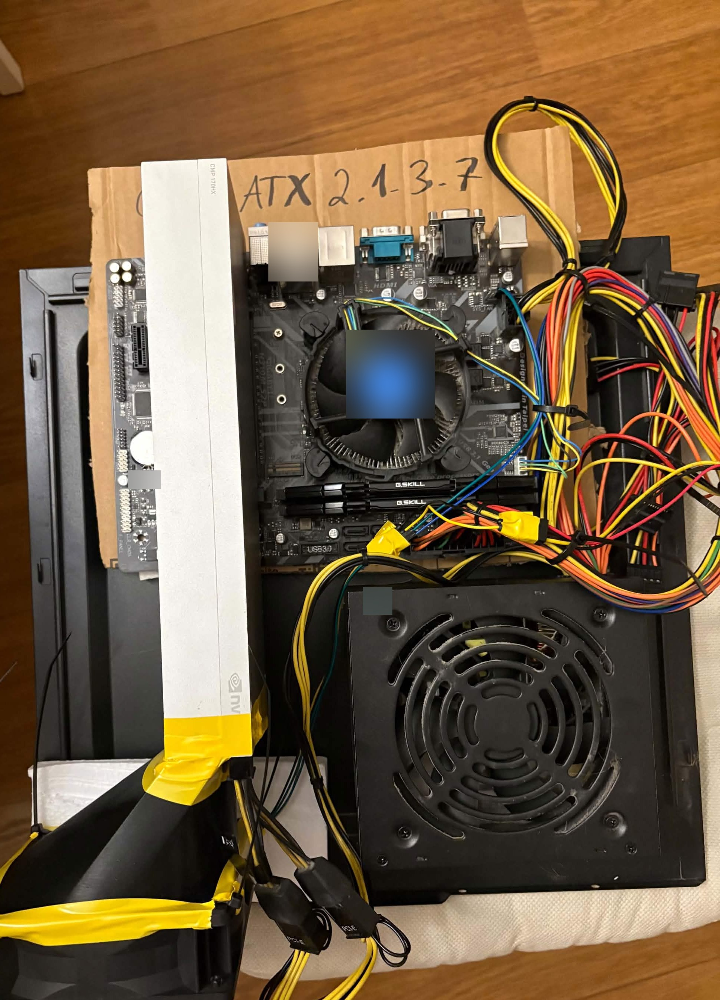
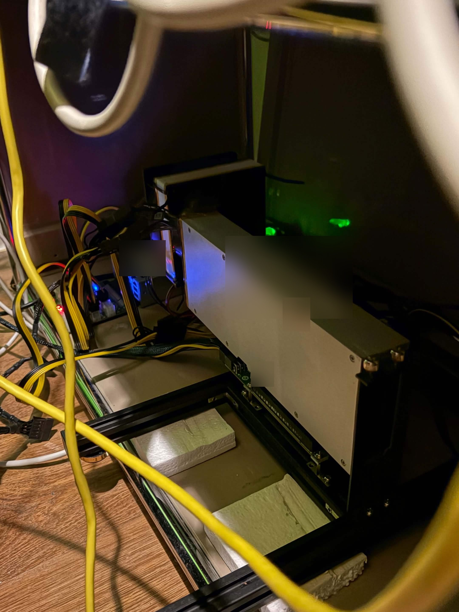

# Opis eksperymentów — Laboratorium 03

**Zespół:** Jan Kaszycki, Wiktor Osior (TrAIningRound)

Ten dokument dokładnie opisuje, co i jak testowaliśmy: dane, prompty, sposób wywołania modeli,
wyniki pojedynczych przypadków i przykłady pełnych interakcji z modelem. Krótkie podsumowanie
z wnioskami jest w [raporcie](report.md), a szczegóły układania contestów w [exp05-contesty.md](exp05-contesty.md).

## Spis treści

1. [Po co te eksperymenty](#1-po-co-te-eksperymenty)
2. [Środowisko](#2-środowisko)
3. [Modele](#3-modele)
4. [Jak wygląda jedno wywołanie modelu](#4-jak-wygląda-jedno-wywołanie-modelu)
5. [Zadanie A: odczyt intencji z czatu (EXP-00 – EXP-04)](#5-zadanie-a-odczyt-intencji-z-czatu-exp-00--exp-04)
6. [Zadanie B: układanie contestu (EXP-05)](#6-zadanie-b-układanie-contestu-exp-05)
7. [Przykłady pełnych interakcji](#7-przykłady-pełnych-interakcji)
8. [Odtworzenie](#8-odtworzenie)

## 1. Po co te eksperymenty

Laboratorium 03 polega na tym, żeby wybór modelu, promptu i parametrów oprzeć na pomiarach. Prowadzący
przygotował zadanie ćwiczebne (piętro i winda z notatki kierowcy). My wykonaliśmy te same eksperymenty
na dwóch zadaniach z naszego projektu TrAIningRound ([wizja](../../../docs/VISION.md)):

- **Zadanie A — odczyt intencji:** agent na czacie musi zrozumieć, czego chce użytkownik: zadanie dla siebie
  czy contest, na jakim poziomie i z jakiego tematu. To pierwszy krok każdej rozmowy.
- **Zadanie B — układanie contestu:** agent dostaje grupę zawodników i pulę zadań i ma wybrać dobry
  zestaw. To jedno z dwóch głównych działań projektu.

## 2. Środowisko

| Element | Wartość |
|---|---|
| Laptop (modele lokalne) | Intel i7-9750HF, NVIDIA GTX 1660 Ti 6 GB VRAM, 31 GB RAM, Linux |
| Serwer (model zdalny) | serwer z kartami NVIDIA CMP 170HX (4× 16 GB), dostęp przez LAN |
| Uruchamianie modeli lokalnie | Ollama 0.40.3 |
| Uruchamianie modelu zdalnie | llama.cpp (`llama serve`), API zgodne z OpenAI |
| Program testowy | C#, .NET 9, projekt `ModelLab` na bazie kodu z repozytorium kursu |

Wszystkie pomiary czasu na laptopie są wykonane na zasilaniu sieciowym. Pierwsza próba na baterii była
kilka razy wolniejsza (GPU pracowało na 300 MHz zamiast ~1100 MHz), więc ją powtórzyliśmy;
log tej próby: [EXP-01-bateria.log](../results/EXP-01-bateria.log).

Serwer, na którym działała gemma-4-31b:

<p>
  
  
</p>

*Rys. 1 (z lewej). Serwer w trakcie montażu: karta NVIDIA CMP 170HX z dodatkowym wentylatorem.*

*Rys. 2 (z prawej). Karta w ramie serwera w miejscu pracy. Naklejki z numerami są zamazane.*

## 3. Modele

| Model | Parametry | Kwantyzacja | Gdzie działał | Uwagi |
|---|---|---|---|---|
| gemma3:4b | 3,9B | Q4_K_M | laptop, w całości na GPU | model polecany w labie |
| qwen3:4b-instruct | 4,0B | Q4_K_M | laptop, w całości na GPU | wersja bez trybu rozumowania |
| qwen2.5-coder:3b | 3,1B | Q4_K_M | laptop, w całości na GPU | najmniejszy model w zestawieniu |
| gemma4:e4b | 7,5B (efektywnie 4B) | Q4_K_M | laptop, część warstw na CPU | 6,6 GB, nie mieści się w 6 GB VRAM |
| gemma-4-31b | 31B | Q8_K_XL | serwer z CMP 170HX, przez LAN | model „myślący”, rozumowanie w osobnym polu `reasoning_content` |

Pierwotnie w EXP-01 był też qwen2.5-coder:7b, ale nie mieścił się w VRAM (44% obliczeń na CPU)
i był bardzo wolny, więc zamieniliśmy go na wersję 3B.

## 4. Jak wygląda jedno wywołanie modelu

Program `ModelLab` dla każdego przypadku testowego:

1. Buduje prompt z szablonu i danych przypadku (wiadomości użytkownika albo grupy zawodników).
2. Wysyła **jedno zapytanie** z jedną wiadomością `user`, bez historii i bez promptu systemowego:
   - modele lokalne: `POST http://localhost:11434/api/chat` (Ollama),
   - model zdalny: `POST <serwer>/v1/chat/completions` (API OpenAI).
3. Ustawia temperaturę (domyślnie 0) i opcjonalnie wymusza format JSON Schema
   (Ollama: pole `format`, OpenAI: `response_format` typu `json_schema`).
4. Mierzy czas od wysłania zapytania do otrzymania całej odpowiedzi (bez strumieniowania).
5. Bierze treść odpowiedzi (`message.content`). Rozumowanie modeli myślących zwracane w osobnym polu
   jest pomijane. Jeśli model otoczył JSON blokiem ```` ```json ````, blok jest zdejmowany.
6. Parsuje JSON i sprawdza typy pól. Odpowiedź, której nie da się sparsować albo która ma zły typ pola,
   liczy się jako błędna.
7. Porównuje wynik z oczekiwanym i dopisuje wiersz do pliku wyników.

Pełne przykłady zapytań i odpowiedzi są w [rozdziale 7](#7-przykłady-pełnych-interakcji).

## 5. Zadanie A: odczyt intencji z czatu (EXP-00 – EXP-04)

### 5.1. Co ma zwrócić model

```json
{ "mode": "solo", "rating_min": 1216, "rating_max": 1216, "topic": "binary search" }
```

| Pole | Wartości | Znaczenie |
|---|---|---|
| `mode` | `"solo"`, `"contest"`, `null` | zadanie dla siebie / contest dla grupy / wiadomość niezwiązana |
| `rating_min`, `rating_max` | liczba albo `null` | zakres trudności; jedna liczba trafia do obu pól, ranga albo dywizja zamienia się na zakres z tabeli progów, `null`, gdy nie da się ustalić |
| `topic` | tag Codeforces albo `null` | temat zadania |

Progi rang i dywizji są wpisane na sztywno w prompt (plik [Codeforces.cs](../src/ModelLab/Codeforces.cs)).
Dywizje traktujemy jako poziom trudności, a nie oficjalne limity ratingu rund.

### 5.2. Zbiór testowy

25 wiadomości napisanych przez nas, z oczekiwanym wynikiem ([messages.csv](../data/messages.csv)).
Wiadomości obejmują przypadki proste i celowo trudne: polskie nazwy technik, zaprzeczenia, kilka dywizji
naraz, odniesienia do historii, wiadomości bez parametrów.

| Id | Wiadomość | Oczekiwany wynik (mode, rating, topic) | Co sprawdza |
|---|---|---|---|
| MSG-001 | Daj mi zadanie z binary searcha, mam 1216 ratingu | solo, 1216..1216, binary search | jedna liczba → oba końce zakresu, temat z potocznej nazwy |
| MSG-002 | Zrób contest dla koła na poziomie Div 2 | contest, 1600..1899, null | dywizja → zakres, „koło” = grupa |
| MSG-003 | Chcę poćwiczyć dp | solo, null..null, dp | sam temat, brak ratingu |
| MSG-004 | Daj coś trudniejszego niż ostatnio | solo, null..null, null | odniesienie do historii, nie zgadywać ratingu |
| MSG-005 | Jestem specialistą, chcę grafy | solo, 1400..1599, graphs | ranga → zakres, polska nazwa tematu |
| MSG-006 | Zorganizuj eliminacje dla 6 osób, wszyscy są zieloni na CF | contest, 1200..1399, null | kolor rangi → zakres, eliminacje = contest |
| MSG-007 | Szykuję się do rozmowy rekrutacyjnej, potrzebuję zadań na stringi | solo, null..null, strings | rozmowa rekrutacyjna, „zadań” w liczbie mnogiej, ale dla siebie |
| MSG-008 | Ułóż rundę jak Div 4 | contest, 800..1399, null | „runda” = contest, dywizja → zakres |
| MSG-009 | Mam rating 1550 i słabo mi idą dwa wskaźniki | solo, 1550..1550, two pointers | polskie tłumaczenie techniki („dwa wskaźniki” = two pointers) |
| MSG-010 | Hej, co potrafisz? | null, null..null, null | wiadomość niezwiązana z zadaniami |
| MSG-011 | Contest z teorii liczb dla expertów | contest, 1600..1899, number theory | ranga w liczbie mnogiej + polski temat |
| MSG-012 | Zadanie 1300-1500 z greedy | solo, 1300..1500, greedy | jawny zakres liczbowy |
| MSG-013 | Chcemy z drużyną potrenować przed ICPC, poziom Div 1 | contest, 1900..null, null | Div 1 bez górnej granicy |
| MSG-014 | Jestem szary, daj coś łatwego z implementacji | solo, 800..1199, implementation | kolor rangi → zakres, „łatwego” nie zmienia zakresu |
| MSG-015 | Nie Div 3, raczej Div 2 — zrób contest | contest, 1600..1899, null | zaprzeczenie: „nie Div 3, raczej Div 2” |
| MSG-016 | Daj zadanie z drzew, poziom Div 3 albo Div 4 | solo, 800..1599, trees | dwie dywizje → zakres obejmujący obie |
| MSG-017 | Jestem candidate masterem i chcę kombinatorykę | solo, 1900..2099, combinatorics | wysoka ranga + polski temat |
| MSG-018 | Załóż contest na 2 godziny | contest, null..null, null | contest bez poziomu i tematu |
| MSG-019 | Kolega ma 1400, ja 1200 — zrób nam wspólny contest | contest, 1200..1400, null | dwie liczby od dwóch osób → zakres |
| MSG-020 | binary search, 1800 | solo, 1800..1800, binary search | bardzo krótka wiadomość |
| MSG-021 | Wczoraj nie wyszło mi zadanie z geometrii, chcę podobne. Mam 1700 | solo, 1700..1700, geometry | długa wiadomość z kontekstem, liczba na końcu |
| MSG-022 | Przygotuj eliminacje do drużyny, zawodnicy od pupila do experta | contest, 1200..1899, null | zakres od rangi do rangi |
| MSG-023 | Daj mi jakieś zadanie | solo, null..null, null | prośba bez żadnych parametrów |
| MSG-024 | Chcę zadanie z dp, ale nie za trudne, jestem newbie | solo, 800..1199, dp | ranga + „nie za trudne” |
| MSG-025 | Daj zadanie z bitmasek na poziomie mastera | solo, 2100..2299, bitmasks | polska nazwa tematu + wysoka ranga |

### 5.3. Przykłady do promptów one-shot i few-shot

Osobne 5 wiadomości ([prompt-examples.csv](../data/prompt-examples.csv)), inne niż testowe, żeby model
nie dostawał gotowej odpowiedzi. One-shot używa pierwszego przykładu, few-shot wszystkich pięciu.

| Id | Wiadomość | Wynik (mode, rating, topic) |
|---|---|---|
| EX-001 | Daj zadanie z sortowania na 1100 | solo, 1100..1100, sortings |
| EX-002 | Zrób contest na poziomie Div 3 | contest, 1400..1599, null |
| EX-003 | Jestem pupilem, chcę coś z matmy | solo, 1200..1399, math |
| EX-004 | Dzień dobry! | null, null..null, null |
| EX-005 | Turniej dla koła z grafów, dla Div 1 | contest, 1900..null, graphs |

### 5.4. Prompt

Prompt zero-shot, dokładnie w tej postaci, w jakiej trafia do modelu (dla MSG-001). Dla innych wiadomości
zmienia się tylko ostatnia linia.

```text
Jesteś agentem do treningu zadań algorytmicznych na Codeforces.
Z wiadomości użytkownika wyodrębnij:
- mode — "solo", gdy użytkownik chce zadanie dla siebie, "contest", gdy chce ułożyć contest, rundę, eliminacje albo trening dla grupy; null, gdy wiadomość nie dotyczy żadnego z nich,
- rating_min i rating_max — zakres trudności; jeśli użytkownik podaje jedną liczbę, wpisz ją w oba pola; jeśli podaje rangę albo dywizję, użyj progów poniżej; jeśli podaje kilka rang lub dywizji, weź zakres obejmujący wszystkie; null, gdy nie da się ustalić konkretnej wartości,
- topic — temat zadania jako tag Codeforces z listy poniżej; null, gdy nie podano tematu.

Nie dopowiadaj brakujących danych.

Dywizje:
- Div 1: od 1900 wzwyż (rating_max = null)
- Div 2: 1600–1899
- Div 3: 1400–1599
- Div 4: 800–1399

Rangi:
- Newbie (szary): 800–1199
- Pupil (zielony): 1200–1399
- Specialist (turkusowy): 1400–1599
- Expert (niebieski): 1600–1899
- Candidate Master (fioletowy): 1900–2099
- Master (pomarańczowy): 2100–2299
- International Master (pomarańczowy): 2300–2399
- Grandmaster (czerwony): 2400–2599
- International Grandmaster (czerwony): 2600–2999
- Legendary Grandmaster (czarno-czerwony): 3000–3500

Tagi: implementation, math, greedy, dp, data structures, brute force, constructive algorithms, graphs, sortings, binary search, dfs and similar, trees, strings, number theory, combinatorics, two pointers, bitmasks, geometry, dsu, shortest paths, probabilities, games, hashing, interactive, divide and conquer, matrices, flows, graph matchings

Zwróć wyłącznie JSON:
{
  "mode": "solo" | "contest" | null,
  "rating_min": liczba całkowita | null,
  "rating_max": liczba całkowita | null,
  "topic": tag | null
}

Wiadomość: "Daj mi zadanie z binary searcha, mam 1216 ratingu"
```

W wariantach one-shot i few-shot przed „Zwróć wyłącznie JSON” dochodzi sekcja z przykładami. Dla few-shot:

```text
Przykłady:
"Daj zadanie z sortowania na 1100" => {"mode":"solo","rating_min":1100,"rating_max":1100,"topic":"sortings"}
"Zrób contest na poziomie Div 3" => {"mode":"contest","rating_min":1400,"rating_max":1599,"topic":null}
"Jestem pupilem, chcę coś z matmy" => {"mode":"solo","rating_min":1200,"rating_max":1399,"topic":"math"}
"Dzień dobry!" => {"mode":null,"rating_min":null,"rating_max":null,"topic":null}
"Turniej dla koła z grafów, dla Div 1" => {"mode":"contest","rating_min":1900,"rating_max":null,"topic":"graphs"}
```

W wariancie `json-schema` (EXP-04) prompt jest ten sam, a dodatkowo do zapytania trafia schemat:

```json
{
  "type": "object",
  "properties": {
    "mode": { "type": ["string", "null"], "enum": ["solo", "contest", null] },
    "rating_min": { "type": ["integer", "null"] },
    "rating_max": { "type": ["integer", "null"] },
    "topic": { "type": ["string", "null"] }
  },
  "required": ["mode", "rating_min", "rating_max", "topic"]
}
```

### 5.5. EXP-00 — metryki

| Metryka | Definicja |
|---|---|
| Mode accuracy | odsetek wiadomości z poprawnym `mode` |
| Rating accuracy | odsetek wiadomości, w których **oba** końce zakresu są poprawne |
| Topic accuracy | odsetek wiadomości z poprawnym tagiem (bez rozróżniania wielkości liter) |
| Exact match | odsetek wiadomości, w których wszystkie pola są poprawne — **główna metryka** |
| Poprawny JSON | odpowiedź da się sparsować i ma wszystkie pola właściwego typu |
| Powtarzalność | (EXP-03) liczba wiadomości, dla których wszystkie powtórzenia dały identyczny wynik |

`null` jest zwykłą wartością: jeśli użytkownik nie podał ratingu, a model wpisze liczbę, to błąd,
bo agent powinien wtedy dopytać albo sprawdzić profil, a nie zgadywać.

### 5.6. EXP-01 — porównanie modeli

**Co się zmienia:** model. **Co stałe:** prompt zero-shot, temperatura 0, bez JSON Schema, te same 25 wiadomości.
**Wywołań:** 25 na model.

| Model | Mode | Rating | Topic | Exact match | Poprawny JSON | Średni czas [ms] |
|---|---|---|---|---|---|---|
| gemma3:4b | 96% | 68% | 64% | **32%** | 25/25 | 3741 |
| qwen3-instr. | 100% | 76% | 92% | **72%** | 25/25 | 1220 |
| coder:3b | 96% | 92% | 96% | **84%** | 25/25 | 939 |
| gemma4:e4b | 92% | 100% | 96% | **88%** | 25/25 | 14968 |
| gemma-4-31b | 100% | 100% | 100% | **100%** | 25/25 | 9145 |

Wynik każdej wiadomości (✓ wszystkie pola poprawne, ✗ błąd):

| Id | gemma3:4b | qwen3-instr. | coder:3b | gemma4:e4b | gemma-4-31b |
|---|---|---|---|---|---|
| MSG-001 | ✗ | ✗ | ✓ | ✓ | ✓ |
| MSG-002 | ✗ | ✓ | ✓ | ✓ | ✓ |
| MSG-003 | ✓ | ✗ | ✓ | ✓ | ✓ |
| MSG-004 | ✗ | ✗ | ✗ | ✗ | ✓ |
| MSG-005 | ✓ | ✓ | ✓ | ✓ | ✓ |
| MSG-006 | ✗ | ✓ | ✓ | ✓ | ✓ |
| MSG-007 | ✓ | ✗ | ✗ | ✓ | ✓ |
| MSG-008 | ✗ | ✓ | ✓ | ✓ | ✓ |
| MSG-009 | ✗ | ✗ | ✗ | ✗ | ✓ |
| MSG-010 | ✗ | ✓ | ✓ | ✓ | ✓ |
| MSG-011 | ✓ | ✓ | ✓ | ✓ | ✓ |
| MSG-012 | ✓ | ✓ | ✓ | ✓ | ✓ |
| MSG-013 | ✗ | ✗ | ✓ | ✓ | ✓ |
| MSG-014 | ✗ | ✓ | ✓ | ✓ | ✓ |
| MSG-015 | ✗ | ✓ | ✓ | ✓ | ✓ |
| MSG-016 | ✗ | ✓ | ✗ | ✓ | ✓ |
| MSG-017 | ✗ | ✓ | ✓ | ✓ | ✓ |
| MSG-018 | ✓ | ✓ | ✓ | ✓ | ✓ |
| MSG-019 | ✗ | ✓ | ✓ | ✓ | ✓ |
| MSG-020 | ✗ | ✓ | ✓ | ✓ | ✓ |
| MSG-021 | ✗ | ✗ | ✓ | ✓ | ✓ |
| MSG-022 | ✗ | ✓ | ✓ | ✓ | ✓ |
| MSG-023 | ✓ | ✓ | ✓ | ✗ | ✓ |
| MSG-024 | ✓ | ✓ | ✓ | ✓ | ✓ |
| MSG-025 | ✗ | ✓ | ✓ | ✓ | ✓ |

Błędne odpowiedzi modeli:

| Id | Oczekiwano | Model: odpowiedź |
|---|---|---|
| MSG-001 | solo, 1216..1216, binary search | gemma3:4b: solo, 1216..null, binary search<br>qwen3-instr.: solo, 1200..1399, binary search |
| MSG-002 | contest, 1600..1899, null | gemma3:4b: contest, 1600..1899, div2 |
| MSG-003 | solo, null..null, dp | qwen3-instr.: solo, 1400..1599, dp |
| MSG-004 | solo, null..null, null | gemma3:4b: solo, null..null, implementation<br>qwen3-instr.: solo, 1600..1899, null<br>coder:3b: solo, 1600..null, null<br>gemma4:e4b: null, null..null, null |
| MSG-006 | contest, 1200..1399, null | gemma3:4b: contest, 1200..1399, pupil |
| MSG-007 | solo, null..null, strings | qwen3-instr.: solo, 1200..1399, strings<br>coder:3b: contest, null..null, strings |
| MSG-008 | contest, 800..1399, null | gemma3:4b: contest, 800..1399, div4 |
| MSG-009 | solo, 1550..1550, two pointers | gemma3:4b: solo, 1500..1599, null<br>qwen3-instr.: solo, 1500..1600, null<br>coder:3b: solo, 1550..1550, null<br>gemma4:e4b: solo, 1550..1550, null |
| MSG-010 | null, null..null, null | gemma3:4b: solo, null..null, null |
| MSG-013 | contest, 1900..null, null | gemma3:4b: contest, 1900..null, teams<br>qwen3-instr.: contest, 1900..null, graphs |
| MSG-014 | solo, 800..1199, implementation | gemma3:4b: solo, 800..null, implementation |
| MSG-015 | contest, 1600..1899, null | gemma3:4b: contest, 1600..1899, null ¹ |
| MSG-016 | solo, 800..1599, trees | gemma3:4b: solo, 1400..1599, trees<br>coder:3b: solo, 1400..1599, trees |
| MSG-017 | solo, 1900..2099, combinatorics | gemma3:4b: solo, 1900..null, combinatorics |
| MSG-019 | contest, 1200..1400, null | gemma3:4b: contest, 1200..1400, div 3 |
| MSG-020 | solo, 1800..1800, binary search | gemma3:4b: solo, 1800..null, binary search |
| MSG-021 | solo, 1700..1700, geometry | gemma3:4b: solo, 1700..null, geometry<br>qwen3-instr.: solo, 1700..1899, geometry |
| MSG-022 | contest, 1200..1899, null | gemma3:4b: contest, 1200..1899, dp |
| MSG-023 | solo, null..null, null | gemma4:e4b: null, null..null, null |
| MSG-025 | solo, 2100..2299, bitmasks | gemma3:4b: solo, 1900..null, bitmasks |

¹ Odpowiedź wygląda jak oczekiwana, ale model wpisał w `topic` tekst `"null"` (w cudzysłowie) zamiast wartości
JSON `null`. W logu obie wersje wyglądają tak samo, a dla programu to temat o nazwie „null”, więc odpowiedź jest błędna.

### 5.7. EXP-02 — zero-shot, one-shot, few-shot

**Co się zmienia:** liczba przykładów w prompcie (0, 1, 5). **Co stałe:** qwen2.5-coder:3b, temperatura 0,
bez JSON Schema. **Wywołań:** 3 × 25.

Model wybraliśmy na podstawie EXP-01: drugi wynik jakości przy najkrótszym czasie odpowiedzi.

| Wariant | Mode | Rating | Topic | Exact match | Średni czas [ms] |
|---|---|---|---|---|---|
| zero-shot | 96% | 92% | 96% | **84%** | 956 |
| one-shot | 96% | 88% | 96% | **80%** | 693 |
| few-shot | 100% | 84% | 96% | **80%** | 704 |

Wiadomości, w których warianty się różnią:

| Id | Oczekiwano | zero-shot | one-shot | few-shot |
|---|---|---|---|---|
| MSG-002 | contest, 1600..1899, null | ✓ | ✓ | ✗ contest, 1600..null, null |
| MSG-004 | solo, null..null, null | ✗ solo, 1600..null, null | ✗ solo, 1600..null, null | ✗ solo, 1600..null, null |
| MSG-007 | solo, null..null, strings | ✗ contest, null..null, strings | ✗ contest, null..null, strings | ✓ |
| MSG-009 | solo, 1550..1550, two pointers | ✗ solo, 1550..1550, null | ✗ solo, 1550..1550, null | ✗ solo, 1550..1550, null |
| MSG-011 | contest, 1600..1899, number theory | ✓ | ✓ | ✗ contest, 1600..null, number theory |
| MSG-015 | contest, 1600..1899, null | ✓ | ✗ contest, 1400..1899, null | ✓ |
| MSG-016 | solo, 800..1599, trees | ✗ solo, 1400..1599, trees | ✗ solo, 1400..2599, trees | ✗ solo, 1400..1599, trees |

Przykład „Div 1 → `1900..null`” w few-shot sprawił, że model zaczął zostawiać `rating_max = null` także
dla Div 2 (MSG-002) i rangi expert (MSG-011). Pełna interakcja: [rozdział 7.4](#74-qwen25-coder3b-few-shot--naśladowanie-przykładu).

### 5.8. EXP-03 — temperatura

**Co się zmienia:** temperatura (0, 0.5, 1.0). **Co stałe:** qwen2.5-coder:3b, prompt zero-shot,
bez JSON Schema. Każda wiadomość jest wysyłana **3 razy** (pierwotnie 5, zmniejszyliśmy ze względu na czas).
**Wywołań:** 3 temperatury × 25 × 3 = 225.

| Temperatura | Mode | Rating | Topic | Exact match | Powtarzalne wiadomości |
|---|---|---|---|---|---|
| 0 | 96% | 92% | 96% | **84%** | 25/25 |
| 0.5 | 92% | 77% | 93% | **71%** | 14/25 |
| 1 | 89% | 68% | 95% | **60%** | 8/25 |

Exact match liczymy ze wszystkich 75 odpowiedzi danej temperatury.
Liczba różnych odpowiedzi na 3 powtórzenia (1 = zawsze to samo):

| Id | t = 0 | t = 0.5 | t = 1.0 |
|---|---|---|---|
| MSG-001 | 1 | 2 | 2 |
| MSG-002 | 1 | 2 | 1 |
| MSG-003 | 1 | 1 | 2 |
| MSG-004 | 1 | 3 | 3 |
| MSG-005 | 1 | 1 | 2 |
| MSG-006 | 1 | 1 | 1 |
| MSG-007 | 1 | 3 | 3 |
| MSG-008 | 1 | 1 | 1 |
| MSG-009 | 1 | 3 | 2 |
| MSG-010 | 1 | 2 | 2 |
| MSG-011 | 1 | 2 | 2 |
| MSG-012 | 1 | 1 | 1 |
| MSG-013 | 1 | 1 | 2 |
| MSG-014 | 1 | 2 | 2 |
| MSG-015 | 1 | 2 | 2 |
| MSG-016 | 1 | 3 | 3 |
| MSG-017 | 1 | 1 | 2 |
| MSG-018 | 1 | 1 | 1 |
| MSG-019 | 1 | 1 | 1 |
| MSG-020 | 1 | 1 | 2 |
| MSG-021 | 1 | 2 | 3 |
| MSG-022 | 1 | 1 | 1 |
| MSG-023 | 1 | 1 | 1 |
| MSG-024 | 1 | 1 | 3 |
| MSG-025 | 1 | 1 | 2 |

Przykład rozrzutu odpowiedzi dla MSG-016 („Daj zadanie z drzew, poziom Div 3 albo Div 4”, oczekiwano
800..1599, trees) przy temperaturze 1.0:

- 1x contest, 1400..null, trees
- 1x solo, 1400..1399, trees
- 1x solo, 1400..1599, trees

### 5.9. EXP-04 — JSON w prompcie a JSON Schema

**Co się zmienia:** sposób wymuszenia formatu. **Co stałe:** qwen2.5-coder:3b, prompt zero-shot, temperatura 0.
**Wywołań:** 2 × 25.

| Wariant | Poprawny JSON | Exact match | Średni czas [ms] |
|---|---|---|---|
| prompt | 25/25 | **84%** | 690 |
| json-schema | 25/25 | **84%** | 678 |

Oba warianty dały identyczne odpowiedzi we wszystkich 25 wiadomościach.
qwen2.5-coder:3b zwraca poprawny JSON także bez schematu. Schemat pilnuje typów, ale nie sensu:
błędy z EXP-01 (MSG-004, MSG-007, MSG-009, MSG-016) zostały.

## 6. Zadanie B: układanie contestu (EXP-05)

Pełny opis z wynikami każdego contestu dla scenariuszy SC-01, SC-02 i SC-04: [exp05-contesty.md](exp05-contesty.md).
Tu jest opis danych i promptu.

### 6.1. Pula zadań

20 zadań z Codeforces z ratingiem 800–1400, wybranych skryptem
[fetch_codeforces_samples.py](../../../scripts/fetch_codeforces_samples.py) z `problemset.problems`
(po 10 z zakresów 800–1200 i 1200–1400, 2–4 tagi, różne tematy). Do promptu trafiają tylko metadane.

| Rating | Zadanie | Nazwa | Tagi |
|---|---|---|---|
| 800 | 1228A | Distinct Digits | brute force, implementation |
| 800 | 996A | Hit the Lottery | dp, greedy |
| 900 | 1011A | Stages | greedy, implementation, sortings |
| 900 | 1324A | Yet Another Tetris Problem | implementation, number theory |
| 900 | 1475A | Odd Divisor | math, number theory |
| 900 | 648A | Наибольший подъем | constructive algorithms, implementation |
| 1000 | 1760D | Challenging Valleys | implementation, two pointers |
| 1100 | 712B | Memory and Trident | implementation, strings |
| 1200 | 1512D | Corrupted Array | constructive algorithms, data structures, greedy |
| 1200 | 2072C | Creating Keys for StORages Has Become My Main Skill | bitmasks, constructive algorithms, greedy |
| 1200 | 2210C1 | A Simple GCD Problem (Easy Version) | greedy, number theory |
| 1200 | 432B | Football Kit | brute force, greedy, implementation |
| 1200 | 6C | Alice, Bob and Chocolate | greedy, two pointers |
| 1300 | 1846E1 | Rudolf and Snowflakes (simple version) | brute force, implementation, math |
| 1300 | 2181A | Alphabet City | binary search, math, strings |
| 1300 | 234C | Weather | dp, implementation |
| 1300 | 508B | Anton and currency you all know | greedy, math, strings |
| 1400 | 203C | Photographer | greedy, sortings |
| 1400 | 2126E | G-C-D, Unlucky! | math, number theory |
| 1400 | 961C | Chessboard | bitmasks, brute force, implementation |

### 6.2. Scenariusze

| Scenariusz | Uczestnicy (rating, rozwiązane zadania z puli) | Używany w ocenie |
|---|---|---|
| SC-01 | szeldon555 1216<br>bstopczynski 1248<br>jkssss 1371 | tak |
| SC-02 | szeldon555 1216<br>bstopczynski 1248<br>jkssss 1371<br>ania_k 1310 (6C, 508B, 203C, 1846E1) * | tak |
| SC-03 | tomek_n 950 (1228A, 996A, 1475A) *<br>szeldon555 1216<br>kasia_ex 1650 (2126E, 961C, 2072C) * | nie: najmocniejszy 1650, pula kończy się na 1400 |
| SC-04 | olek 900 (1228A, 996A, 648A) *<br>zosia 1000 (1011A, 1324A, 1475A) *<br>piotr 1100 (1760D) * | tak |
| SC-05 | marek 1700 (961C, 203C, 2126E, 234C) *<br>ewa 1850 (2181A, 1846E1, 508B, 1512D) *<br>jkssss 1371 | nie: najmocniejszy 1850, pula kończy się na 1400 |

\* konto wymyślone; pozostałe to prawdziwe konta z Codeforces (rating z 21.10.2026). Prawdziwi zawodnicy
nie rozwiązali żadnego zadania z puli, więc wymyślone osoby z rozwiązanymi zadaniami sprawdzają, czy model
omija zadania, które ktoś już zna.

### 6.3. Prompt

Prompt dla SC-02 dokładnie w tej postaci, w jakiej trafia do modelu. Dla innych scenariuszy zmienia się
tylko lista uczestników.

```text
Jesteś agentem, który układa contesty treningowe z zadań Codeforces dla grupy zawodników.
Wybierz dokładnie 4 zadania z puli tak, żeby contest był uczciwy:
- żaden uczestnik nie rozwiązał wcześniej żadnego z wybranych zadań,
- trudność pasuje do poziomu grupy: najłatwiejsze zadanie da się zrobić dla najsłabszego uczestnika, a najtrudniejsze jest wyzwaniem dla najmocniejszego,
- zadania są ułożone od najłatwiejszego do najtrudniejszego,
- tematy są możliwie różne.
Uzasadnij wybór w 2–4 zdaniach.

Uczestnicy:
- szeldon555: rating 1216, rozwiązane zadania z puli: brak
- bstopczynski: rating 1248, rozwiązane zadania z puli: brak
- jkssss: rating 1371, rozwiązane zadania z puli: brak
- ania_k: rating 1310, rozwiązane zadania z puli: 6C, 508B, 203C, 1846E1

Pula zadań (id | rating | tagi | nazwa):
- 1228A | rating 800 | brute force, implementation | Distinct Digits
- 996A | rating 800 | dp, greedy | Hit the Lottery
- 1011A | rating 900 | greedy, implementation, sortings | Stages
- 1324A | rating 900 | implementation, number theory | Yet Another Tetris Problem
- 1475A | rating 900 | math, number theory | Odd Divisor
- 648A | rating 900 | constructive algorithms, implementation | Наибольший подъем
- 1760D | rating 1000 | implementation, two pointers | Challenging Valleys
- 712B | rating 1100 | implementation, strings | Memory and Trident
- 1512D | rating 1200 | constructive algorithms, data structures, greedy | Corrupted Array
- 2072C | rating 1200 | bitmasks, constructive algorithms, greedy | Creating Keys for StORages Has Become My Main Skill
- 2210C1 | rating 1200 | greedy, number theory | A Simple GCD Problem (Easy Version)
- 432B | rating 1200 | brute force, greedy, implementation | Football Kit
- 6C | rating 1200 | greedy, two pointers | Alice, Bob and Chocolate
- 1846E1 | rating 1300 | brute force, implementation, math | Rudolf and Snowflakes (simple version)
- 2181A | rating 1300 | binary search, math, strings | Alphabet City
- 234C | rating 1300 | dp, implementation | Weather
- 508B | rating 1300 | greedy, math, strings | Anton and currency you all know
- 203C | rating 1400 | greedy, sortings | Photographer
- 2126E | rating 1400 | math, number theory | G-C-D, Unlucky!
- 961C | rating 1400 | bitmasks, brute force, implementation | Chessboard

Zwróć wyłącznie JSON:
{
  "problems": ["id", ...],
  "justification": "uzasadnienie"
}
```

Do zapytania zawsze dochodzi JSON Schema `{"problems": [string], "justification": string}` i temperatura 0.

### 6.4. Kryteria i wyniki

| Kryterium | Warunek |
|---|---|
| Poprawny | dokładnie 4 różne zadania z puli |
| Nierozwiązane | żaden uczestnik nie rozwiązał wcześniej wybranego zadania |
| Start | najłatwiejsze zadanie od (najsłabszy − 500) do najsłabszego |
| Koniec | najtrudniejsze zadanie od (najmocniejszy − 100) do (najmocniejszy + 300) |
| Rozrzut | różnica ratingów najtrudniejszego i najłatwiejszego co najmniej 200 (kolejność dowolna) |
| Tematy | każde zadanie ma co najmniej jeden tag, którego nie mają pozostałe trzy |
| Uzasadnienie | co najmniej 40 znaków |

Contest jest **dobry**, gdy spełnia wszystkie kryteria. Słowa „uczciwy” używamy tylko w węższym znaczeniu
kryterium „Nierozwiązane”: nikt z grupy nie zna wcześniej żadnego zadania, więc nikt nie ma przewagi.

Wyniki dla SC-01, SC-02 i SC-04 (dobre contesty z 3):

| Model | Dobre | Średni czas [s] |
|---|---|---|
| gemma-4-31b | 3/3 | 55.6 |
| gemma4:e4b | 2/3 | 62.3 |
| qwen3-instr. | 2/3 | 8.9 |
| gemma3:4b | 0/3 | 12.5 |
| coder:3b | 0/3 | 6.9 |

Każdy z 18 contestów z zadaniami, tagami, błędami i uzasadnieniem modelu: [exp05-contesty.md](exp05-contesty.md).

## 7. Przykłady pełnych interakcji

Poniższe interakcje nagraliśmy tym samym kodem co eksperymenty (komenda `DEMO`, zapis zapytań
włączany zmienną `MODELLAB_TRACE`). Surowe zapisy z wszystkimi polami odpowiedzi są w
[results/demo/](../results/demo/). Prompt dla zadania A jest za każdym razem taki jak w [rozdziale 5.4](#54-prompt),
więc poniżej pokazujemy go w całości tylko w pierwszym przykładzie.

### 7.1. qwen2.5-coder:3b — poprawna odpowiedź (pełny zapis)

Zapytanie wysłane do Ollamy (`POST http://localhost:11434/api/chat`):

```json
{
  "model": "qwen2.5-coder:3b",
  "messages": [
    {
      "role": "user",
      "content": "Jesteś agentem do treningu zadań algorytmicznych na Codeforces.\nZ wiadomości użytkownika wyodrębnij:\n- mode — \"solo\", gdy użytkownik chce zadanie dla siebie, \"contest\", gdy chce ułożyć contest, rundę, eliminacje albo trening dla grupy; null, gdy wiadomość nie dotyczy żadnego z nich,\n- rating_min i rating_max — zakres trudności; jeśli użytkownik podaje jedną liczbę, wpisz ją w oba pola; jeśli podaje rangę albo dywizję, użyj progów poniżej; jeśli podaje kilka rang lub dywizji, weź zakres obejmujący wszystkie; null, gdy nie da się ustalić konkretnej wartości,\n- topic — temat zadania jako tag Codeforces z listy poniżej; null, gdy nie podano tematu.\n\nNie dopowiadaj brakujących danych.\n\nDywizje:\n- Div 1: od 1900 wzwyż (rating_max = null)\n- Div 2: 1600–1899\n- Div 3: 1400–1599\n- Div 4: 800–1399\n\nRangi:\n- Newbie (szary): 800–1199\n- Pupil (zielony): 1200–1399\n- Specialist (turkusowy): 1400–1599\n- Expert (niebieski): 1600–1899\n- Candidate Master (fioletowy): 1900–2099\n- Master (pomarańczowy): 2100–2299\n- International Master (pomarańczowy): 2300–2399\n- Grandmaster (czerwony): 2400–2599\n- International Grandmaster (czerwony): 2600–2999\n- Legendary Grandmaster (czarno-czerwony): 3000–3500\n\nTagi: implementation, math, greedy, dp, data structures, brute force, constructive algorithms, graphs, sortings, binary search, dfs and similar, trees, strings, number theory, combinatorics, two pointers, bitmasks, geometry, dsu, shortest paths, probabilities, games, hashing, interactive, divide and conquer, matrices, flows, graph matchings\n\nZwróć wyłącznie JSON:\n{\n  \"mode\": \"solo\" | \"contest\" | null,\n  \"rating_min\": liczba całkowita | null,\n  \"rating_max\": liczba całkowita | null,\n  \"topic\": tag | null\n}\n\nWiadomość: \"Daj mi zadanie z binary searcha, mam 1216 ratingu\""
    }
  ],
  "stream": false,
  "options": {
    "temperature": 0
  }
}
```

Odpowiedź Ollamy:

```json
{
  "model": "qwen2.5-coder:3b",
  "created_at": "2026-10-22T09:27:19.713048836Z",
  "message": {
    "role": "assistant",
    "content": "{\n  \"mode\": \"solo\",\n  \"rating_min\": 1216,\n  \"rating_max\": 1216,\n  \"topic\": \"binary search\"\n}"
  },
  "done": true,
  "done_reason": "stop",
  "total_duration": 7660859576,
  "load_duration": 5143017817,
  "prompt_eval_count": 681,
  "prompt_eval_cached_count": 0,
  "prompt_eval_duration": 2020108000,
  "eval_count": 41,
  "eval_duration": 491701000
}
```

Program bierze `message.content`, parsuje JSON i porównuje z oczekiwanym wynikiem:
`solo, 1216..1216, binary search` — **poprawnie**. Przy pierwszym zapytaniu Ollama ładuje model do pamięci
(`load_duration` ≈ 5 s); w eksperymentach dotyczy to tylko pierwszej wiadomości danego modelu.

### 7.2. qwen2.5-coder:3b — nieznany polski termin

**Wiadomość użytkownika:** "Mam rating 1550 i słabo mi idą dwa wskaźniki"  
**Parametry zapytania:** `{"model": "qwen2.5-coder:3b", "stream": false, "options": {"temperature": 0}}`

**Surowa odpowiedź modelu** (`message.content`):

````text
{
  "mode": "solo",
  "rating_min": 1550,
  "rating_max": 1550,
  "topic": null
}
````

**Czas:** 0,6 s (w tym ładowanie modelu 0,0 s), tokeny promptu: 684, tokeny odpowiedzi: 39

Oczekiwano `topic = "two pointers"`. Model nie powiązał polskiego „dwa wskaźniki” z angielskim tagiem z listy i wpisał `null`. Ten błąd popełniły wszystkie modele lokalne; poprawnie odpowiedziała tylko gemma-4-31b.

### 7.3. gemma3:4b — tekst spoza listy tagów i blok kodu

**Wiadomość użytkownika:** "Ułóż rundę jak Div 4"  
**Parametry zapytania:** `{"model": "gemma3:4b", "stream": false, "options": {"temperature": 0}}`

**Surowa odpowiedź modelu** (`message.content`):

````text
```json
{
  "mode": "contest",
  "rating_min": 800,
  "rating_max": 1399,
  "topic": "Div 4"
}
```
````

**Czas:** 11,1 s (w tym ładowanie modelu 8,1 s), tokeny promptu: 624, tokeny odpowiedzi: 52

Dwa problemy naraz: model otoczył JSON blokiem ```` ```json ```` mimo prośby o sam JSON (program to obsługuje) i wpisał do `topic` dywizję („Div 4”), której nie ma na liście tagów. Oczekiwano `topic = null`.

### 7.4. qwen2.5-coder:3b, few-shot — naśladowanie przykładu

**Wiadomość użytkownika:** "Zrób contest dla koła na poziomie Div 2"  
**Parametry zapytania:** `{"model": "qwen2.5-coder:3b", "stream": false, "options": {"temperature": 0}}`

**Surowa odpowiedź modelu** (`message.content`):

````text
{
  "mode": "contest",
  "rating_min": 1600,
  "rating_max": null,
  "topic": null
}
````

**Czas:** 7,3 s (w tym ładowanie modelu 4,4 s), tokeny promptu: 870, tokeny odpowiedzi: 34

W zero-shot ta wiadomość daje poprawne `1600..1899`. W few-shot model skopiował wzór z przykładu „Turniej dla koła z grafów, dla Div 1” → `1900..null` i zostawił górną granicę pustą także dla Div 2.

### 7.5. qwen3:4b-instruct — contest dla SC-02

**Uczestnicy (część promptu):**

```text
- szeldon555: rating 1216, rozwiązane zadania z puli: brak
- bstopczynski: rating 1248, rozwiązane zadania z puli: brak
- jkssss: rating 1371, rozwiązane zadania z puli: brak
- ania_k: rating 1310, rozwiązane zadania z puli: 6C, 508B, 203C, 1846E1
```

**Parametry zapytania:** `{"model": "qwen3:4b-instruct", "stream": false, "options": {"temperature": 0}}` + JSON Schema w polu `format`

**Surowa odpowiedź modelu:**

```json
{
  "justification": "Ania_k już rozwiązała 6C, 508B, 203C i 1846E1, więc te zadania są wykluczone. Najniższy rating uczestników to 1216, więc zadania o ratingach poniżej 1200 są za łatwe, a zadania o ratingach powyżej 1400 są za trudne. Wybieram zadania o ratingach 900–1300 z różnymi tematami: 1011A (greedy, sortings), 1475A (math, number theory), 2181A (binary search, strings) i 2126E (math, number theory). Zadania są nieprzecięczone, ułożone od łatwego do trudnego, a tematy są różne.",
  "problems": ["1011A", "1475A", "2181A", "2126E"]
}
```

**Wybrane zadania posortowane według ratingu:**

| Rating | Zadanie | Tagi |
|---|---|---|
| 900 | 1011A | greedy, implementation, sortings |
| 900 | 1475A | math, number theory |
| 1300 | 2181A | binary search, math, strings |
| 1400 | 2126E | math, number theory |

**Czas:** 13,8 s

Ocena: wszystkie zadania nierozwiązane, start 900 (dozwolone 716–1216), koniec 1400 (dozwolone 1271–1671), rozrzut 500 — ale **tematy ✗**: 1475A i 2126E mają te same tagi [math, number theory], więc żadne z nich nie wnosi własnego tematu. Uzasadnienie twierdzi, że zadania poniżej 1200 są „za łatwe”, a model sam wybrał 900. **Uwaga:** w eksperymencie ten sam model z tym samym promptem i temperaturą 0 wybrał inny zestaw (1228A, 1011A, 1760D, 2181A). Temperatura 0 w Ollamie nie gwarantuje identycznych odpowiedzi.

### 7.6. qwen2.5-coder:3b — contest dla SC-04

**Uczestnicy (część promptu):**

```text
- olek: rating 900, rozwiązane zadania z puli: 1228A, 996A, 648A
- zosia: rating 1000, rozwiązane zadania z puli: 1011A, 1324A, 1475A
- piotr: rating 1100, rozwiązane zadania z puli: 1760D
```

**Parametry zapytania:** `{"model": "qwen2.5-coder:3b", "stream": false, "options": {"temperature": 0}}` + JSON Schema w polu `format`

**Surowa odpowiedź modelu:**

```json
{
  "problems": ["1228A", "996A", "1011A", "1324A"],
  "justification": "Wybrane zadania są łatwe i łatwiejsze niż zadania, które rozwiązałoby najsłabszy z uczestników. Zadania są również różnorodne w tematach, co pomaga rozwiązać je w różnym stylu. Najłatwiejsze zadanie (1228A) jest dla najsłabszego uczestnika, a najtrudniejsze (1324A) jest wyzwaniem dla najmocniejszego. Dodatkowo, zadania są ułożone od najłatwiejszego do najtrudniejszego, co pomaga uczestnikom rozwiązać je w porządku."
}
```

**Wybrane zadania posortowane według ratingu:**

| Rating | Zadanie | Tagi |
|---|---|---|
| 800 | 1228A | brute force, implementation |
| 800 | 996A | dp, greedy |
| 900 | 1011A | greedy, implementation, sortings |
| 900 | 1324A | implementation, number theory |

**Czas:** 8,6 s

Wszystkie cztery zadania są już rozwiązane (1228A i 996A przez olka, 1011A i 1324A przez zosię), mimo że lista rozwiązanych jest w prompcie. To te same zadania, które model wybrał w każdym scenariuszu: pierwsze z listy. Uzasadnienie brzmi rozsądnie i niczego z tego nie zauważa.

### 7.7. gemma-4-31b — contest dla SC-01

Serwer z gemma-4-31b był niedostępny podczas nagrywania przykładów, więc pokazujemy odpowiedź zapisaną
w eksperymencie ([contest-results.csv](../results/contest-results.csv)). Odtworzona z zapisanych pól:

```json
{
  "problems": [
    "996A",
    "1760D",
    "2072C",
    "2126E"
  ],
  "justification": "Zestaw obejmuje bardzo różnorodne tematy: DP, two pointers, bitmaski oraz teorię liczb. Trudność zadań rośnie od 800 do 1400 punktów, co zapewnia dostępność dla najsłabszego uczestnika i odpowiednie wyzwanie dla najsilniejszego."
}
```

| Rating | Zadanie | Tagi |
|---|---|---|
| 800 | 996A | dp, greedy |
| 1000 | 1760D | implementation, two pointers |
| 1200 | 2072C | bitmasks, constructive algorithms, greedy |
| 1400 | 2126E | math, number theory |

**Czas:** 40,2 s. Contest spełnia wszystkie kryteria: start 800 (dozwolone 716–1216), koniec 1400
(dozwolone 1271–1671), cztery różne tematy. Model zwraca też rozumowanie w polu `reasoning_content`, którego nie zapisywaliśmy
w eksperymencie; przy próbnym zapytaniu wyglądało to tak (skrót odpowiedzi serwera):

```json
{
  "message": {
    "role": "assistant",
    "content": "```json\n{\"a\":1}\n```",
    "reasoning_content": "*   Input: \"Zwróć JSON {\"a\":1}\" (Polish for \"Return JSON {\"a\":1}\")\n    *   Goal: Output the specific JSON object `{\"a\":1}`. ..."
  },
  "timings": { "prompt_per_second": 53.9, "predicted_per_second": 70.7 }
}
```

## 8. Odtworzenie

Z katalogu `experiments/lab03-models-and-prompting` (wymaga Ollamy z modelami z [rozdziału 3](#3-modele)):

```bash
dotnet run --project src/ModelLab -- EXP-01
```

```bash
dotnet run --project src/ModelLab -- EXP-02 qwen2.5-coder:3b
```

```bash
dotnet run --project src/ModelLab -- EXP-03 qwen2.5-coder:3b
```

```bash
dotnet run --project src/ModelLab -- EXP-04 qwen2.5-coder:3b
```

```bash
dotnet run --project src/ModelLab -- EXP-05
```

```bash
OPENAI_BASE_URL=http://adres-serwera:port/v1 dotnet run --project src/ModelLab -- EXP-01 openai/gemma-4-31b:Q8_K_XL
```

```bash
MODELLAB_TRACE=results/demo/przyklad.txt dotnet run --project src/ModelLab -- DEMO intent qwen2.5-coder:3b MSG-009
```

```bash
dotnet run --project src/ModelLab -- EXP-05-RESCORE
```

Wyniki zbiorcze trafiają do `results/results.csv` i `results/contest-results.csv`, a pełne odpowiedzi
do logów `results/EXP-XX.log`.
